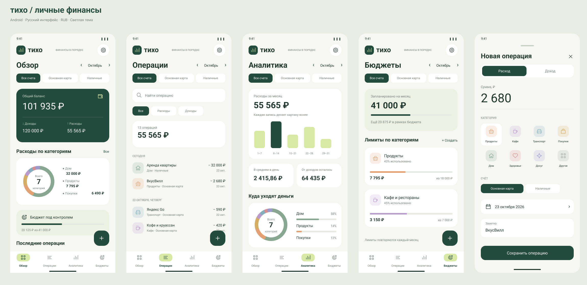

# Тихо — личные финансы

Нативное Android-приложение на Kotlin и Jetpack Compose. Русский интерфейс, рубли, светлая тема. Минимальная версия — Android 10 (API 29).

[Редактируемый дизайн в Figma](https://www.figma.com/design/OLxKGunSXiumZ1zmyysMG6?node-id=3-383)



## Что работает

- Обзор текущего баланса, доходов и расходов за выбранный месяц.
- Расходы и доходы: сумма до копейки, категория, счёт, дата и заметка.
- Добавление, редактирование и удаление с возможностью отмены удаления.
- Два настраиваемых счёта: карта и наличные, название и начальный остаток.
- История с поиском, фильтрами по типу операции, категории, счёту и месяцу.
- Аналитика: недельные расходы, круговая диаграмма, доли категорий, средние расходы в день, сравнение с предыдущим месяцем при наличии данных.
- Повторяющиеся месячные лимиты по категориям, прогресс и превышение бюджета.
- Экспорт всех операций в CSV с UTF-8 BOM для Excel.
- JSON-копия и восстановление счетов, операций и бюджетов с полной проверкой файла и атомарной заменой данных.
- Данные SQLite сохраняются между запусками. Приложение не запрашивает доступ в интернет.
- Демопример по отдельной кнопке и очистка данных с подтверждением.

## Первый запуск

Откройте папку Finance в Android Studio, дождитесь Gradle Sync, выберите конфигурацию `app` и нажмите Run. Для сборки нужен JDK 21 и Android SDK 36.1.

Приложение запускается с пустым списком. Добавьте первую операцию кнопкой «+» или нажмите «Посмотреть на примере». В настройках можно задать начальные остатки счетов. После знакомства с примером используйте «Начать с чистого листа».

Суммы вводятся в рублях: `1234,56` или `1234.56`. Отрицательные суммы не нужны: тип операции задаёт направление. Баланс отражает начальные остатки и все проведённые операции, а месячные суммы — только выбранный период. Фильтр счёта влияет на расходы в бюджете; сами лимиты общие для всех счетов.

## Сборка и проверки

```powershell
# Укажите путь к своему JDK 21. На компьютере проекта:
$env:JAVA_HOME = 'C:/Program Files/Android/Android Studio1/jbr'
./gradlew.bat :app:assembleDebug :app:testDebugUnitTest :app:lintDebug

# С запущенным эмулятором:
./gradlew.bat :app:connectedDebugAndroidTest
```

APK: `app/build/outputs/apk/debug/app-debug.apk`. Это отладочная сборка для установки и проверки; публикация в Google Play потребует собственного release-ключа.

Проверки покрывают точность денежных сумм, границы месяцев, балансы счетов, SQLite CRUD, сохранение после повторного открытия, JSON round-trip и защиту данных при некорректном импорте. Сквозной Compose-тест проходит экраны, добавление, поиск, пересоздание Activity и редактирование операции.

## Структура

- `FinanceData.kt` — модели, расчёты в целых копейках, SQLiteOpenHelper и ViewModel; операции с БД выполняются на Dispatchers.IO.
- `ui/FinanceApp.kt` — экраны и формы Compose, навигация, экспорт и импорт через системный выбор файла.
- `ui/theme/` — общие цвета и типографика; иконки — векторные контуры.
- `docs/research.md` — исследование аналогов и принятые решения.
- `docs/figma-design.png` — экспорт макетов из Figma.
- `docs/screenshots/` — реальные экраны из эмулятора.

## Границы версии 1.0

Учёт ведётся вручную, в RUB. Банковская синхронизация, облачная учётная запись, переводы между счетами, автоматические платежи, пользовательские категории и конвертация валют в эту версию не входят. Счета и данные можно перенести через резервную копию. Локальная база защищается стандартной изоляцией Android, отдельного PIN-кода и шифрования базы в приложении нет.

Восстановление из копии заменяет текущие данные после подтверждения. JSON и CSV содержат ваши операции в читаемом виде — храните копии в подходящем для личных данных месте.
